  

  
  
  
  
  
  

---

# ⚡ Awesome Multi-Agent Synchronization Busses

> 🌐 **Curated List of SaaS Platforms & Open-Source Projects for Low-Latency State Management, Agent-to-Agent (A2A) Messaging & Distributed Multi-Agent Coordination.**

Welcome to the definitive ecosystem directory tracking infrastructure for **Multi-Agent Systems (MAS)** and **Agent Synchronization Busses**. As autonomous AI agents transition from standalone prompt pipelines to cooperative swarms, they require low-latency communication backbones and reliable distributed state management. 

These synchronization busses enable heterogeneous agents to discover peers, publish/subscribe to domain events, share persistent memory contexts, perform cryptographic capability handshakes, and coordinate complex multi-step workflows across process boundaries, Kubernetes clusters, edge nodes, and multi-cloud environments.

---

## 📑 Table of Contents

- [📊 Sector Overview & Market Dynamics](#-sector-overview--market-dynamics)
- [☁️ SaaS & Hosted Platforms](#️-saas--hosted-platforms)
- [🐙 Open-Source GitHub Projects](#-open-source-github-projects)
- [🛠️ Protocol Bridges & Core Transport Layers](#️-protocol-bridges--core-transport-layers)
- [🤝 How to Contribute](#-how-to-contribute)
- [🔒 Security & Architectural Disclaimer](#-security--architectural-disclaimer)
- [📈 Star History](#-star-history)
- [💖 Support & Community](#-support--community)
- [🏷️ Keywords & Search Discovery](#️-keywords--search-discovery)

---

## 📊 Sector Overview & Market Dynamics

The global **Agentic AI & Multi-Agent Systems** infrastructure sector is estimated at **$7.0 Billion – $11.5 Billion in 2025–2026** and is accelerating at an extraordinary Compound Annual Growth Rate (CAGR) of **~40% to 48%**, projected to surpass **$35 Billion – $50 Billion by 2030**.

### 🧩 Market Dynamics: High Fragmentation vs. Hyperscaler Concentration
- **High Ecosystem Fragmentation:** Unlike mature enterprise software markets dominated by a single winner-take-all vendor, the agent synchronization and orchestration layer is currently **highly fragmented**. Innovation is split between open interoperability protocols (e.g., Google/LF A2A, Anthropic MCP, Matrix Decentralized Chat, LF AGNTCY SLIM) and specialized workflow graph engines.
- **Hyperscaler Layer Separation:** Cloud hyperscalers (Microsoft Azure, AWS, Google Cloud) dominate underlying foundation model inference and bare compute, but developer platforms demand transport-agnostic, federated synchronization fabrics that operate seamlessly across multiple LLM providers and hybrid cloud-to-edge topologies without vendor lock-in.

---

## ☁️ SaaS & Hosted Platforms

The table below lists top managed multi-agent platforms and synchronization layers, sorted in **descending order by company size** (market capitalization / valuation):

| 🏢 Platform / Service | 💼 Company & Valuation / Size | 💳 Pricing (Starting Tier) | 🎁 Free Tier Limit | 🚀 Core Synchronization Capabilities |
| :--- | :--- | :--- | :--- | :--- |
| **[AutoGen Studio](https://microsoft.github.io/autogen/)** | **Microsoft Corporation** 📊 Valuation: **$3.12 Trillion** *(Market Cap)* 💰 Annual Rev: ~$245B+ | **$0.0004 / 1k tokens** on Azure AI Foundry ($0.000024/vCPU-s on Azure Container Apps) | **$200 Azure credit for 30 days** + 180,000 vCPU-seconds/mo free on Azure Container Apps + free playground testing | Visual multi-agent conversation interface with event-driven messaging, group chat managers, and hosted Azure cloud runtimes. |
| **[Semantic Kernel](https://learn.microsoft.com/en-us/semantic-kernel/)** | **Microsoft Corporation** 📊 Valuation: **$3.12 Trillion** *(Market Cap)* 💰 Annual Rev: ~$245B+ | **$0.15 / 1M tokens** for GPT-4o mini via Azure OpenAI / Azure AI Services | **$200 Azure credit for 30 days** + 55+ always-free services + 500,000 tokens/mo free on select Azure AI Foundry models | Enterprise multi-agent orchestration SDK with Azure AI Foundry hosting, memory connectors, vector stores, and structured agent chat loops. |
| **[LangGraph Platform](https://www.langchain.com/langgraph)** | **LangChain, Inc.** 📊 Valuation: **~$200 Million** 💰 Total Funding: $35M (Sequoia) | **$39 / seat / month** *(Plus Plan)* + $0.001/node execution for high-volume overage | **Free forever for 1 seat**, includes up to 100,000 node executions/mo and 5,000 traces/mo with local dev server | Cyclic multi-agent graph coordination, serverless background task workers, time-travel state persistence, and human-in-the-loop streaming APIs. |
| **[CrewAI Enterprise](https://www.crewai.com/)** | **CrewAI, Inc.** 📊 Valuation: **~$100 Million** 💰 Total Funding: $18M (Series A) | **$25 / month** *(Starter / Pro Plan)* | **Free forever for 1 user**, includes 50 workflow executions/month and full access to CrewAI Studio visual editor | Role-based collaborative multi-agent orchestration, delegated task routing, automated execution logs, and enterprise agent team governance. |
| **[Relevance AI](https://relevanceai.com/)** | **Relevance AI** 📊 Valuation: **~$100 Million** 💰 Total Funding: $24M | **$29 / month** *($19/mo billed annually)* for Pro Plan | **Free forever for 1 user**, includes 200 Actions/month, 1 project workspace, and ~$2 in bonus model vendor credits | Autonomous B2B agent workforces, multi-agent task handovers, deterministic tool-calling guardrails, and meeting/calling agent workflows. |
| **[Letta Cloud](https://www.letta.com/)** | **Letta, Inc.** *(formerly MemGPT)* 📊 Valuation: **~$50 Million** 💰 Total Funding: $10M (Felicis) | **$20 / month** *(Pro Plan)* / $20 per seat/month *(Teams Pro)* | **Free forever for 1 user**, includes up to 3 persistent stateful agents with Bring-Your-Own-Key (BYOK) model execution | Persistent multi-tier memory synchronization across agent interactions, self-editing contextual memory blocks, and inter-agent messaging APIs. |
| **[MindStudio](https://www.mindstudio.ai/)** | **YouAI, Inc.** 📊 Valuation: **~$40 Million** 💰 Total Funding: $7.5M+ | **$20 / month** *($16/mo billed annually)* for Starter Plan | **Free forever for 1 user**, includes 1 active agent, 1,000 runs/month, and access to the MindStudio 200+ AI model router | No-code collaborative agent workspace with multi-agent coordination, 500+ pre-built tool actions, step debuggers, and pass-through token pricing. |
| **[Flowise Cloud](https://flowiseai.com/)** | **FlowiseAI** 📊 Valuation: **~$25 Million** 💰 Total Funding: $3.5M (Y Combinator) | **$35 / month** for Starter Plan | **Free forever for 1 user**, includes 2 active flows, 2 assistants, 100 predictions/month, and 5 MB storage (with 14-day free trial on Starter Plan) | Drag-and-drop visual multi-agent graph builder with LangChain/LlamaIndex hooks, conversational memory buffers, and webhook integration endpoints. |

---

## 🐙 Open-Source GitHub Projects

The following table showcases top open-source multi-agent synchronization busses, coordination protocols, and distributed state management frameworks. Projects are **sorted strictly in descending order by GitHub stargazers count**:

| 🏷️ Repository | 🌟 Stars Badge | 🛠️ Primary Tech | 📖 Description & Architectural Focus |
| :--- | :--- | :--- | :--- |
| **[MetaGPT](https://github.com/geekan/MetaGPT)** |  | Python | Multi-agent framework assigning diverse roles (Product Manager, Architect, Engineer, QA) with standardized operating procedures (SOPs) to form collaborative software teams. |
| **[AutoGen](https://github.com/microsoft/autogen)** |  | Python, C# | Next-gen multi-agent conversation framework enabling multi-agent chat loops, event-driven agent messaging, asynchronous orchestration, and human-in-the-loop workflows. |
| **[CrewAI](https://github.com/crewAIInc/crewAI)** |  | Python | Collaborative multi-agent framework orchestrating autonomous role-playing agents with delegated task execution, tool sharing, hierarchical processes, and flow pipelines. |
| **[Flowise](https://github.com/FlowiseAI/Flowise)** |  | TypeScript, Node.js | Visual drag-and-drop orchestration UI and API engine for building customized LLM chains, multi-agent supervisory networks, and persistent memory nodes. |
| **[LangGraph](https://github.com/langchain-ai/langgraph)** |  | Python, TypeScript | Graph-based orchestration library for building robust, stateful multi-actor applications with cyclic control flows, time-travel memory inspection, and built-in fault tolerance. |
| **[ChatDev](https://github.com/OpenBMB/ChatDev)** |  | Python | Virtual software organization operating multi-agent cooperative dialogue networks (CEO, CPO, CTO, Programmer) communicating through simulated multi-phase chats. |
| **[Semantic Kernel](https://github.com/microsoft/semantic-kernel)** |  | C#, Python, Java | Microsoft's enterprise-grade SDK integrating LLMs with native code, providing multi-agent chat orchestration, planner abstractions, and distributed vector memory connectors. |
| **[A2A Protocol](https://github.com/a2aproject/A2A)** |  | Python, Spec | Foundational open protocol donated to the Linux Foundation enabling opaque agents to discover each other, negotiate capabilities, exchange messages, and federate across organizational boundaries. Interoperable with Anthropic MCP. |
| **[Letta](https://github.com/letta-ai/letta)** |  | Python | Stateful agent framework (formerly MemGPT) featuring hierarchical memory tiers, self-editing agent memory context blocks, and persistent inter-agent communication channels. |
| **[NATS Server](https://github.com/nats-io/nats-server)** |  | Go | High-performance messaging system with JetStream persistence, distributed Key-Value stores, and real-time pub/sub acting as a foundational low-latency backbone for multi-agent synchronization. |
| **[CAMEL](https://github.com/camel-ai/camel)** |  | Python | Communicative Agents for "Mind" Exploration of LLM Societies. Pioneering communicative multi-agent framework featuring autonomous role-playing and scalable agent communication graphs. |
| **[agentgateway](https://github.com/agentgateway/agentgateway)** |  | Rust | High-performance data plane for agentic AI connectivity across frameworks. Delivers drop-in security, MCP/A2A-focused RBAC, multi-tenancy, dynamic xDS configuration, and Kubernetes Gateway API deployment. |
| **[MindRoom](https://github.com/mindroom-ai/mindroom)** |  | Python, Matrix | AI-native multi-agent workspace built directly on the Matrix protocol. Each agent operates as a Matrix user with end-to-end encryption (E2EE), thread relations, container-isolated execution, and per-tool authorization. |
| **[SLIM (AGNTCY)](https://github.com/agntcy/slim)** |  | Rust, Go, Python | Secure Low-Latency Interactive Messaging (SLIM) bus by Linux Foundation's AGNTCY project. Provides publish/subscribe messaging, Messaging Layer Security (MLS) encryption, and capability schemas for cross-organization agent swarms. |
| **[Protolink](https://github.com/nmaroulis/protolink)** |  | Python | Lightweight production-ready Python framework implementing and extending Google's A2A protocol. Provides in-process shared memory agent communication, OAuth 2.0 security, agent discovery, and streaming. |
| **[OpenAgentIO](https://github.com/ModulationAI/openagentio)** |  | Python, Matrix | Conversation-aware runtime bus and bridge layer for heterogeneous agent ecosystems. Maps MCP servers, Matrix chat rooms, and HTTP/SSE streams into a unified publish/subscribe bus model. |
| **[agentkit StateStore](https://github.com/vinayprograms/agentkit)** |  | Go | Shared state management for distributed multi-agent systems in Go. Implements StateStore interfaces with Key-Value storage, TTL expiration, pattern-based Watch notifications, and NATS JetStream KV locking. |
| **[agent-daemon](https://github.com/Clouder0/agent-daemon)** |  | Rust | Edge-side event dispatch daemon for Agent Native Domains. Converts NATS JetStream streaming events into local agent handler invocations with durable offline delivery and self-evolving handlers. |
| **[atlasic](https://github.com/mashiike/atlasic)** |  | Go | A2A Toolkit library for supervisor-style multi-agent collaborative architectures in Go. Includes AgentService with async job queues, TaskLocker for concurrent execution safety, and JWT auth. |

---

## 🛠️ Protocol Bridges & Core Transport Layers

Architecting a resilient multi-agent synchronization stack frequently involves composing specialized protocols and transport layers:

- **🔗 Interoperability Protocols:**
  - **[A2A Protocol](https://github.com/a2aproject/A2A):** Open specification for agent identification, capability negotiation, and secure message routing across different framework ecosystems.
  - **[Model Context Protocol (MCP)](https://modelcontextprotocol.io/):** Standardized interface for connecting foundation models to external data sources, enterprise tools, and local development contexts.
  - **[AGNTCY OASF & SLIM](https://github.com/agntcy):** Open Agent Schema Framework and MLS-encrypted messaging for federated multi-agent systems across enterprise boundaries.

- **⚡ High-Throughput Messaging & Event Busses:**
  - **[NATS JetStream](https://github.com/nats-io/nats-server):** Cloud-native messaging system delivering microsecond pub/sub, durable event streaming, and distributed Key-Value state storage.
  - **[Redis Pub/Sub & Redis Streams](https://redis.io/):** Low-latency memory-tier event notification, task queues, and cache invalidation for distributed agents.
  - **[Matrix Protocol](https://matrix.org/):** Open standard for decentralized, end-to-end encrypted real-time communication, ideal for treating agents as first-class chat participants.

---

## 🤝 How to Contribute

Contributions to expand and update this ecosystem guide are warmly welcomed! 🌟

1. 🍴 **Fork the repository** to your personal GitHub account.
2. 🌿 **Create a dedicated branch**: `git checkout -b feature/add-new-bus`
3. 📝 **Add your project**: Follow the existing format and ensure all details are factual and neutral:
   - For **SaaS products**: include company name, estimated valuation/size, verified entry-tier pricing, and specific free tier limits.
   - For **Open-Source projects**: include repo link, tech stack, accurate description, and ensure it is placed in the star-sorted list.
4. 🚀 **Commit your changes**: `git commit -m "feat: add AwesomeAgentBus to open-source synchronization list"`
5. 📤 **Push and create a Pull Request**: Submit your PR with a concise description explaining why the tool is relevant.

---

## 🔒 Security & Architectural Disclaimer

- **Community Curated:** This repository provides an independent community compilation for architectural research; inclusion does not constitute an official endorsement.
- **Agent Attack Surfaces:** Inter-agent communication creates unique security vectors, including prompt injection cascading, unauthorized delegation loops, and privilege escalation. System architects should enforce cryptographic message signing, hop-count execution limits, and strict container isolation.
- **Compliance & Privacy:** When synchronizing state across organizational boundaries, ensure compliance with GDPR, HIPAA, CCPA, and enterprise zero-trust security postures.

---

## 📈 Star History

---

## 💖 Support & Community

Thank you for exploring **Awesome Multi-Agent Synchronization Busses**! If this curated ecosystem helps streamline your multi-agent architecture:

- ⭐ **Star this repository** to amplify visibility within the open-source community.
- 🍴 **Fork & Share** with team members and AI engineering groups.
- 💬 **Join the Discussion** on Discord and GitHub Discussions.
- ☕ **Sponsor Ongoing Research**: Support continuous updates, benchmarks, and ecosystem maintenance via the [GitHub Sponsors Dashboard](https://github.com/sponsors/ishandutta2007).

---

## 🏷️ Keywords & Search Discovery

`multi-agent systems` • `agent synchronization bus` • `agent-to-agent protocol` • `A2A protocol` • `model context protocol` • `MCP` • `LangGraph` • `CrewAI` • `AutoGen` • `MetaGPT` • `Flowise` • `ChatDev` • `Letta` • `MemGPT` • `distributed state management` • `event-driven architecture` • `pub-sub messaging` • `NATS JetStream` • `Matrix protocol` • `agentic AI` • `autonomous agent orchestration` • `AI agent coordination` • `shared state memory`
